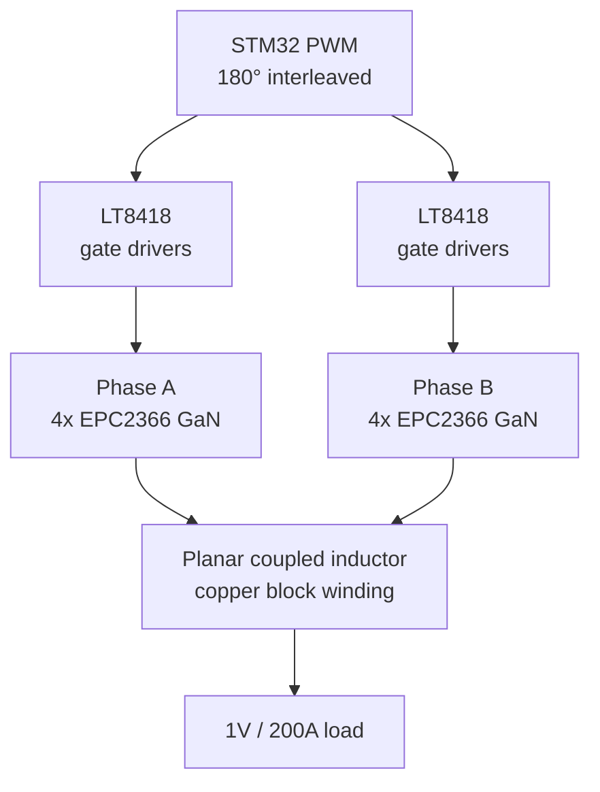

## Introduction

Modern AI and HPC processors draw **hundreds of amperes at around 1V**. The final converter before the chip, the point-of-load (PoL) stage, has to deliver that current efficiently while fitting in the tiny space around the processor.

For my MSc thesis at **DTU Electro**, I designed, built and tested a PoL converter for the department's grid-to-chip research. Their architecture lowers the intermediate bus from the usual 12V to **5V**, which roughly halves the conversion ratio and makes high efficiency at high current more achievable.

The project covered the full power electronics development cycle: **topology, magnetics, semiconductor selection, gate drive, simulation, PCB layout, bring-up and lab validation**, all in six months.

## Specification

| Parameter | Value |
|---|---|
| Input voltage | 4-6V (5V nominal) |
| Output voltage | 1V |
| Output current | 100-200A |
| Switching frequency | 400kHz |
| Footprint | 10 x 10mm, max 7mm high |

## Architecture

- **Two-phase interleaved synchronous buck** with a coupled inductor, so the phase ripple currents partly cancel at the output.
- **Custom planar coupled inductor** on a TDK ELP 14 N87 core, using a solid embedded copper block instead of PCB windings.
- **Paralleled GaN FETs:** two EPC2366 (0.84mΩ) per switch, mirrored on the top and bottom of the board to halve on-resistance within the area limit.
- **LT8418 half-bridge drivers** with separate turn-on and turn-off gate resistors to tune switching edges.

## Magnetics

The coupled inductor was designed analytically and then checked with **Ansys finite-element analysis**. At 400kHz, the current crowds to the edges of the copper block, which the FEA showed clearly and which guided the winding cross-section.

_Ansys current density in the copper block winding_

## Simulation

Before manufacturing, the design was verified at two levels:

- **PLECS** for system behaviour: output voltage, phase and summed ripple currents.
- **LTspice** with device models for switching behaviour, gate drive and input rail sag.

## PCB Design

The converter is built on an **8-layer PCB with blind vias** in Altium. The stack-up is mirrored: top layers hold the devices with a ground plane directly underneath to keep the switching loop small, the inner layers carry the input and switch node, and the bottom half repeats this for the second set of GaN FETs.

_Altium render of the power stage: coupled inductor, GaN FETs and input capacitors_

_8-layer stack-up with blind vias_

_Assembled prototype: phases A and B, GaN FETs and the copper block windings_

## Testing

The board was tested at DTU with scriptable server power supplies, an electronic load, a Tektronix oscilloscope and a FLIR thermal camera.

_Lab setup_

Bring-up was the most valuable part of the project. Key findings and fixes:

- **Low coupling coefficient:** the assembled inductor coupled less than designed and the converter oscillated. Reducing the air gap from 1mm to about 0.2mm fixed it.
- **Gate driver failures:** input rail noise destroyed the drivers at around 30A, so they were moved to a separate clean 5V supply.
- **Gate resistance tuning:** measured the trade-off between ringing and switching loss, settling on 4.02Ω.
- **PWM phase error:** the two timers drifted to 209° instead of 180°. Fixed with a hardware master/slave timer setup.

_Steady-state operation at 100A: input voltage, switch node, inductor current and output ripple_

## Results

| Metric | Result |
|---|---|
| Steady-state output current | **100A** |
| Peak output current | **140A** |
| Efficiency at 100A | **88.7 ± 1.2%** |
| Output ripple at 100A | ~300mV |

_Thermal image under high load, hottest points at the high-side FETs and input capacitors_

The 200A target was limited by **heat**, mainly from resistance in the input path (copper pours and vias) and core saturation. These were traced with IPC-2221 calculations, Altium current-density analysis and LTspice, and give a clear path for a second revision.

## Next Steps

- Replace each paralleled pair with a single **EPC2378** (0.41mΩ), allowing a single-sided design with lower parasitics.
- Thicker input copper and more vias to cut input-path losses.
- Tighter L1-L2 dielectric to reduce switching loop inductance.

The embedded copper block winding concept is already being used as inspiration for ongoing work at DTU Electro.

If you have a high-current power design you'd like to discuss, feel free to reach out.
